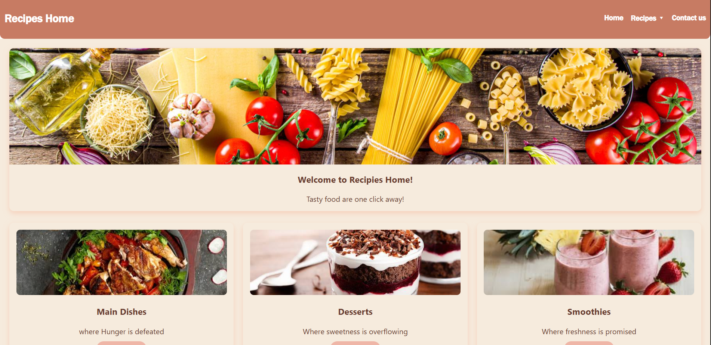
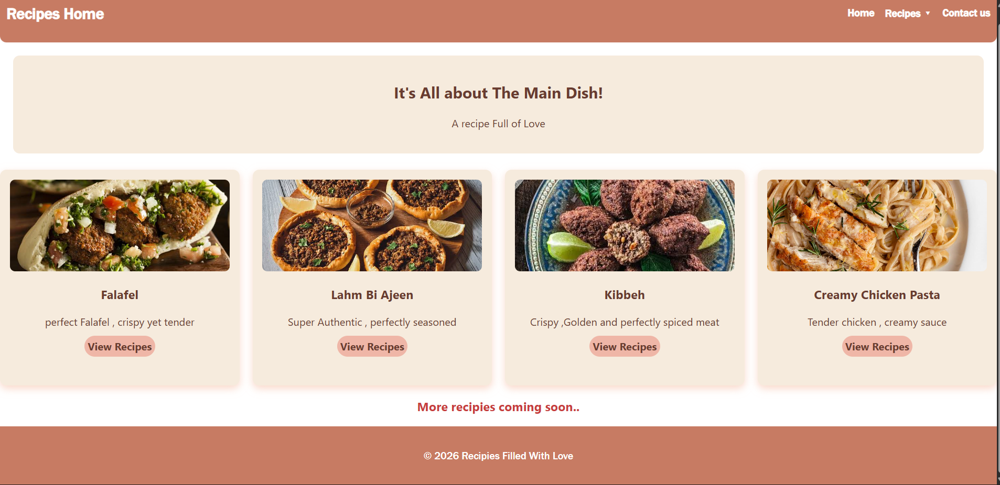
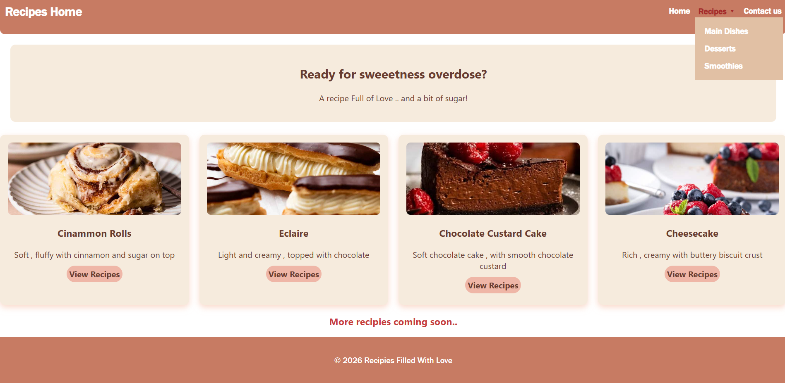
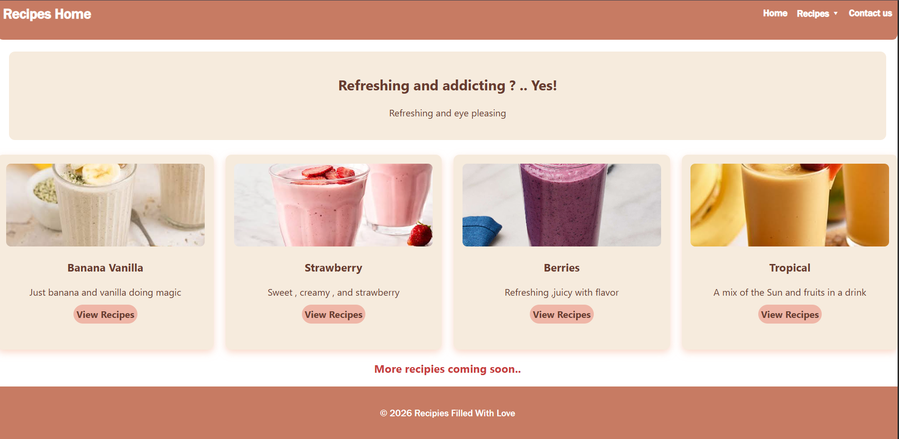
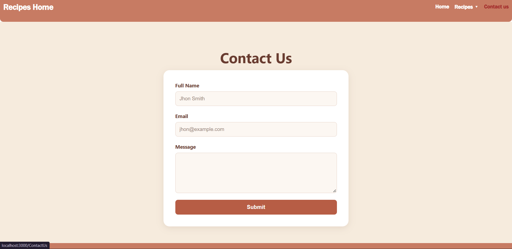

Project Description:

Recipie Home is a responsive recipe website developed using React.js for the CSCI426 Advanced Web Programming course.
The website allows users to explore recipes divided into three categories: Main Dishes, Desserts, and Smoothies.

The website includes five pages:

-Home: Displays a welcome section and introduces the recipe categories.

-Main Dishes: Includes Falafel, Lahm Bi Ajeen, Creamy Chicken Pasta, and Kibbeh.

-Desserts: Includes Éclairs, Cheesecake, Chocolate Custard Cake, and Cinnamon Rolls.

-Smoothies: Includes Strawberry, Banana Vanilla, Mixed Berries, and Tropical Smoothies.

-Contact Us: Provides a form where visitors can enter their name, email, and message.

-The project uses React components, props, state management, event handling, React Router, and CSS for styling and responsiveness.

Setup Instructions:

-Download or clone the repository from GitHub.

-Open the project folder in Visual Studio Code.

-Make sure Node.js and npm are installed.

-Open the terminal in the project directory.

-Install the required dependencies: npm install

-Start the React application: npm start

Screenshots of the UI

Home Page:

Main Dish Page :

Desserts:

Smoothies:

Contact Us :

